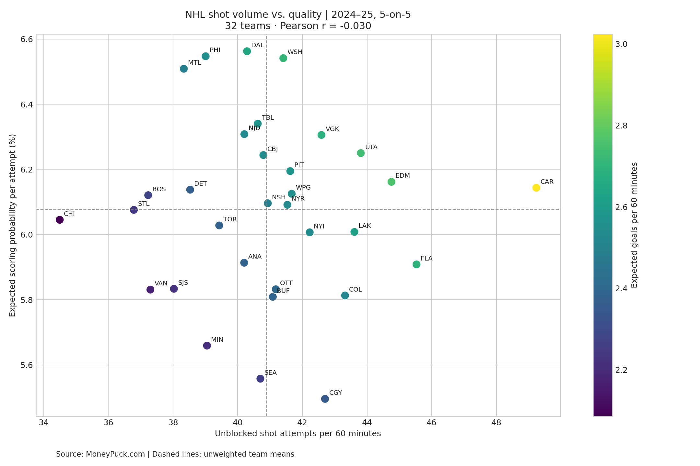

# NHL Shot Volume vs. Shot Quality

A reproducible, one-hour exploratory analysis of all 32 NHL teams in the 2024–25 regular season, restricted to 5-on-5 play.

## Finding

**Teams that generated more unblocked attempts did not consistently generate better or worse average chances.** Pearson correlation was **−0.0299** and Spearman correlation was **−0.0202**. Removing each team in turn left Pearson between **−0.0706 and +0.0182**.

| Team | Unblocked attempts/60 | Expected scoring probability/attempt | xG/60 |
|---|---:|---:|---:|
| Carolina | 49.23 | 6.14% | 3.02 |
| Dallas | 40.29 | 6.56% | 2.64 |
| Vancouver | 37.30 | 5.83% | 2.18 |

Carolina led in volume; Dallas led in average quality. Carolina generated about 22% more attempts per 60 than Dallas. Its higher volume outweighed its lower average quality in expected-goals output.



## Run locally

Requires Python 3.10 or newer. Extract the ZIP, open a terminal in this folder, and run:

```bash
python -m venv .venv
# macOS/Linux:
source .venv/bin/activate
# Windows PowerShell, instead:
# .venv\Scripts\Activate.ps1
python -m pip install -r requirements.txt
python analyze.py
```

The included CSV means the analysis runs offline after installing dependencies. To use the notebook, install Jupyter (`python -m pip install notebook`) and open `analysis.ipynb` with `jupyter notebook`.

## Definitions and methods

- Volume = unblocked shot attempts / ice time in seconds × 3,600.
- Quality = expected goals / unblocked shot attempts.
- Unblocked attempts include goals, saved shots, and misses; blocked shots are excluded.
- xG/60 = volume × quality. This is an identity, not an independent finding.
- Each team receives equal weight in correlations. Spearman uses average ranks for ties.
- Checks verify season, unique team records, completeness, positive denominators, probability bounds, and the metric identity.
- Leave-one-team-out correlations check whether one team drives the result. They are not confidence intervals.

## One-hour workflow

| Minutes | Task |
|---|---|
| 0–10 | Read the question, definitions, and data provenance |
| 10–20 | Inspect CSV and validate 32 five-on-five team records |
| 20–30 | Calculate volume, quality, and xG/60 |
| 30–45 | Inspect the scatterplot and compare offensive styles |
| 45–55 | Calculate correlations and leave-one-team-out sensitivity |
| 55–60 | Write the conclusion and limitations |

## Limitations

This is a descriptive cross-sectional comparison of one season, not evidence that changing a team's shot rate causes its average quality to change. Team aggregation can conceal game-level relationships. Score state, opponents, roster composition, and tactical choices are not controlled for. Expected goals are model estimates, not observed scoring percentages. The attempt denominator is shared across metrics, creating potential ratio effects. The result concerns linear and monotonic association, not every possible dependence.

## Data provenance and usage

Data credit: **MoneyPuck.com**.

- [Data and usage terms](https://moneypuck.com/data.htm)
- [Original 2024–25 regular-season team CSV](https://moneypuck.com/moneypuck/playerData/seasonSummary/2024/regular/teams.csv)
- Retrieved October 16, 2026; the source snapshot is included in `data/teams_2024.csv`.
- `results/summary.json` records the source SHA-256 hash for reproducibility.

MoneyPuck describes this data as free for non-commercial use and requests attribution. The original data retains its source's terms; no ownership or unrestricted license to the data is claimed here.

## Files

- `analyze.py`: validated calculation and chart generation.
- `analysis.ipynb`: short notebook walkthrough.
- `data/teams_2024.csv`: original 160-row snapshot across five situations.
- `results/team_metrics.csv`: 32-team derived metrics.
- `results/summary.json`: correlations and source hash.
- `results/volume_vs_quality.png`: scatterplot.
- `requirements.txt`: Python dependencies.
