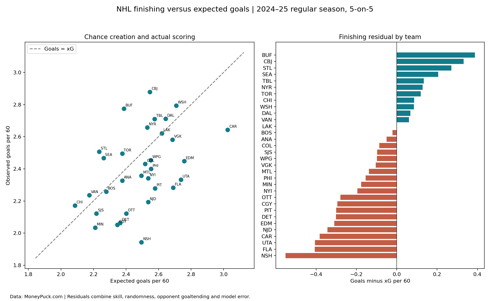

# NHL Finishing: Goals versus Expected Goals

**Question:** Which teams scored more or fewer goals than their chance quality and volume would suggest?

This project uses the shared MoneyPuck 2024–25 regular-season team CSV at `../../data/teams_2024.csv`. It restricts analysis to 5-on-5 and normalizes by ice time. It demonstrates rate construction, residual analysis, validation, and clear communication of model limitations.

## Findings

- Expected and observed goals per 60 had Pearson correlation **0.471** across 32 teams.
- Buffalo had the highest positive residual per 60: **+0.387**, or **25.83 goals above xG** over the season.
- Nashville had the lowest residual per 60: **−0.552**, or **36.91 goals below xG**.
- Across all teams, observed goals totaled **5,230**, versus **5,420.72 xG**. This aggregate difference cautions against treating zero residual as a perfectly calibrated benchmark.

## Run

From the repository root, install `requirements.txt`, then run:

```bash
python projects/nhl-finishing/analyze.py
```

Alternatively open `analysis.ipynb` in this folder. The script runs offline with the included data. `results/team_finishing.csv` contains every team and `results/summary.json` contains exact results.



## Method

1. Validate 32 unique teams, season, complete fields and positive exposure.
2. Divide goals and expected goals by ice time in seconds, then multiply by 3,600.
3. Calculate goals minus xG in totals and per 60 minutes.
4. Compare expected and observed rates using Pearson correlation.
5. Rank residuals and compare each team to the identity line.

## Interpretation limits

A positive residual means goals exceeded the model estimate. It does **not** prove sustainable finishing talent or luck. Residuals combine player skill, random outcomes, opponent goaltending, and model error. The xG model may not be calibrated perfectly for this season. This is an in-sample descriptive comparison, not an out-of-sample prediction or causal analysis. Per-60 denominators are shared by both rates. Do not extrapolate a team ranking to next season without a longitudinal test.

## Source

Data credit: [MoneyPuck.com](https://moneypuck.com/data.htm). Original CSV: https://moneypuck.com/moneypuck/playerData/seasonSummary/2024/regular/teams.csv . Snapshot retrieved October 16, 2026. Source data retains MoneyPuck's terms, including non-commercial use and attribution.

## One-hour workflow

10 minutes inspect data; 15 minutes build and validate rates; 15 minutes visualize; 10 minutes compare outliers; 10 minutes write findings and limitations.
