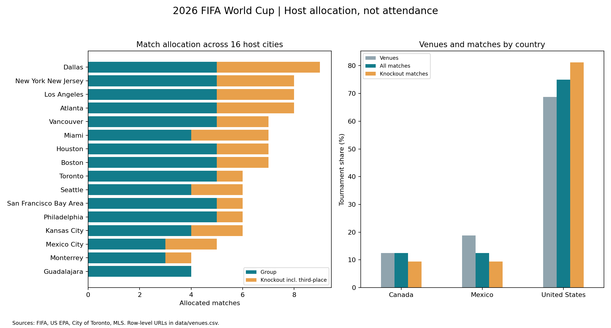

# World Cup 2026: Host-City Match Allocation

**Question:** How evenly were tournament matches and knockout rounds allocated among the three host nations, and what was Vancouver's share?

This project creates a source-linked 16-row CSV from official schedule descriptions. It demonstrates data provenance, group-by aggregation, reconciliation, share calculations, and operations-focused visualization.

## Findings

- The United States received **78 of 104 matches (75.0%)** and **26 of 32 knockout matches (81.25%)**.
- Canada and Mexico each received **13 matches (12.5%)**.
- Vancouver received **7 matches**, **53.85%** of Canada’s allocation, tied for **fifth** by match count.
- Dallas had the largest allocation: **9 matches**.

## Run

From the repository root, install `requirements.txt`, then run:

```bash
python projects/world-cup-host-allocation/analyze.py
```

Alternatively open `analysis.ipynb` in this folder. No network access is needed. Results include venue and country CSVs, a JSON summary, and the chart below.



## Data and definitions

`data/venues.csv` is a manually curated schedule dataset, **not** a downloaded attendance dataset. Each row has its source URL and retrieval date. Host-city labels refer to tournament markets, not necessarily stadium municipalities.

Stage columns count allocated matches. Knockout totals include the third-place match. Match share is matches divided by 104; venue share is venues divided by 16. The allocation index is match share divided by venue share. An index of 1 means equal matches per venue, not fairness or economic efficiency.

Validation reconciles stage totals to 72 group games, 16 round-of-32 games, 8 round-of-16 games, 4 quarterfinals, 2 semifinals, 1 third-place game and 1 final. Country totals reconcile to FIFA's 13 Canada, 13 Mexico, and 78 United States matches.

## Sources and scope

- US venues: https://www.epa.gov/WC2026/host-city-information
- Canadian and Mexican venues: individual FIFA, Toronto and MLS URLs in the input CSV.
- Country reconciliation: https://gpcustomersupportfwc2026.tickets.fifa.com/hc/en-gb/articles/28784328150429-6-How-many-matches-will-each-country-host-during-the-FIFA-World-Cup-2026
- Retrieved October 16, 2026. Counts describe the published allocation, not an independently audited match log.

The user's supplied World Cup report inspired the question. Its attendance, capacity utilization, revenue, fan-festival, and travel-distance claims are **not** used here because their underlying datasets were not supplied or validated for this analysis. Match inventory cannot establish attendance, economic benefit, travel burden, or stadium occupancy. No inferential significance test is needed for this complete allocation table.

## One-hour workflow

15 minutes inspect sources and transcribe counts; 10 minutes reconcile stages; 15 minutes aggregate by country; 10 minutes visualize; 10 minutes explain Vancouver's footprint and limitations.
