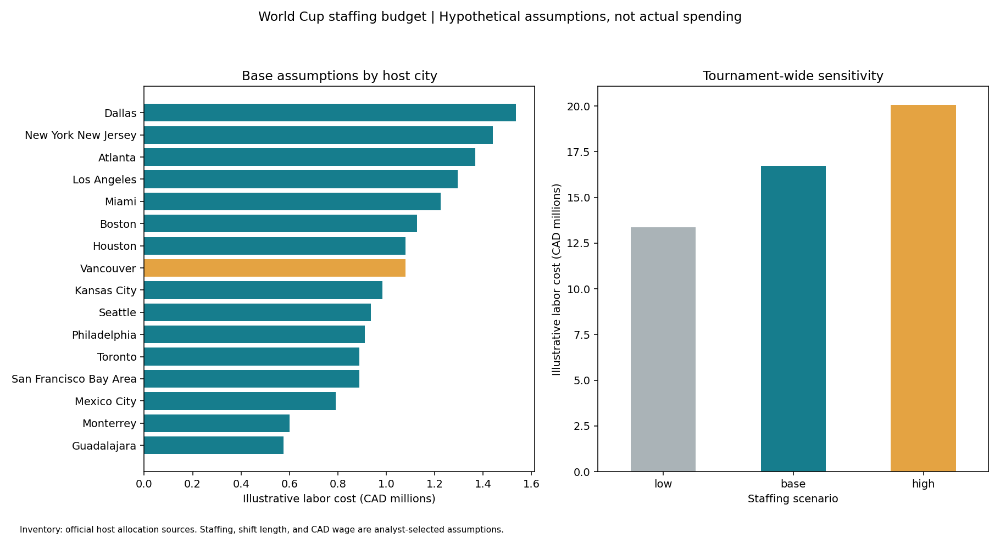

# World Cup Staffing Scenarios with SQL

**Question:** How do match allocation and stage-specific staffing assumptions affect an illustrative labor budget?

This project combines the sourced 104-match allocation with analyst-selected assumptions using SQLite joins, CTEs, aggregation, and window functions. All monetary outputs are **hypothetical scenario estimates**, not FIFA, city, or stadium spending.

## Findings under the included assumptions

| Scenario | Tournament labor cost (CAD) |
|---|---:|
| Low: 80% of base staffing | 13,382,400 |
| Base | 16,728,000 |
| High: 120% of base staffing | 20,073,600 |

- Vancouver's base scenario is **36,000 staff-hours**, costing **CAD 1,080,000**.
- Dallas has the highest modeled base cost, **CAD 1,536,000**, reflecting its nine-match allocation and stage mix.
- The ±20% sensitivity is linear for the supplied inputs because the staffing counts remain integers. It is an assumption-driven sensitivity, not an empirical discovery or confidence interval.



## Reproduce

From the repository root, install `requirements.txt`, then run:

```bash
python projects/world-cup-staffing/analyze.py
```

Or open `analysis.ipynb` in this folder. Python's built-in SQLite needs no extra dependency. `queries.sql` contains the analytical query. The script loads three in-memory tables, executes the SQL and exports city/country scenario CSVs, a JSON summary and a chart.

## Inputs

- **Observed allocation:** shared `../world-cup-host-allocation/data/venues.csv`; official source URLs are recorded per row. The 16 cities sum to 104 matches.
- **Illustrative assumptions:** `data/stage_assumptions.csv`. Staff per match: 600 group, 700 round of 32, 800 round of 16, 1,000 quarterfinal, 1,200 semifinal, 1,000 third-place and 1,500 final. All shifts last 8 hours at a uniform CAD 30/hour.
- **Scenario controls:** `data/scenarios.csv` applies 0.8, 1.0 or 1.2 to staff counts. Fractional staff counts round up to whole people.

These staffing levels, shift hours, wage and scenarios are deliberately selected for teaching. They have no claimed empirical basis. CAD is a uniform accounting unit for all countries, with no exchange-rate model.

## Model

`labor cost = matches × rounded-up scenario staff per match × hours per shift × hourly rate`

Staff-shifts count repeated assignments; they do not represent unique employees. This is variable match-day labor only. It excludes benefits, payroll taxes, overtime, training, travel, accommodation, contractors, fixed costs, and differences in local wages. It is not a staffing recommendation or a complete event budget.

## SQL skills and validation

- Reshape wide stage counts into a normalized match inventory.
- Join stage assumptions with a many-to-one relationship.
- Cross join scenarios to compare alternatives without overwriting inputs.
- Use CTEs, `GROUP BY`, `RANK()` and windowed sums for ranks and shares.
- Validate assumption coverage, positive values, 16-city uniqueness and 104 matches per scenario.
- Independently reconcile SQL cost totals against a pandas calculation.

## One-hour plan

10 minutes review sources and assumptions; 15 minutes build normalized tables; 15 minutes write SQL; 10 minutes reconcile calculations; 10 minutes visualize and explain sensitivity.
