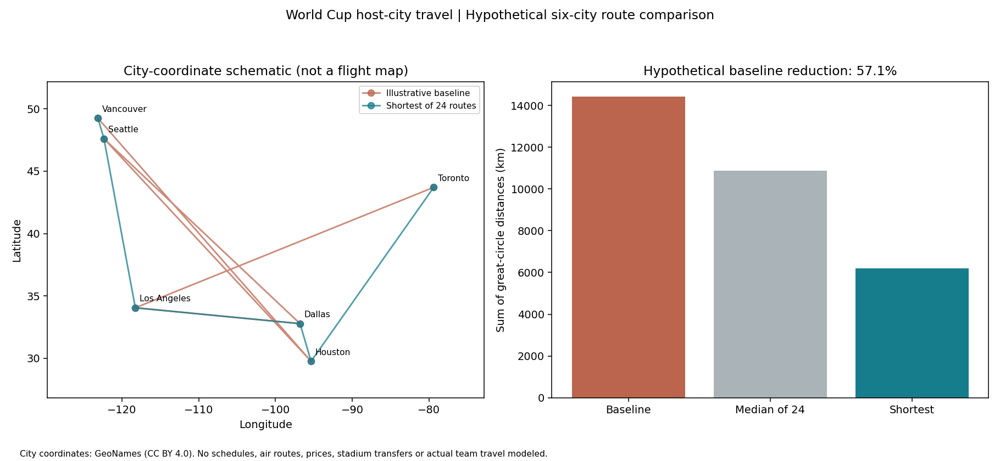

# World Cup Host-City Travel Optimization

**Question:** How much can visit order affect distance on a hypothetical six-city tour?

This Python project uses real GeoNames city coordinates and exhaustive permutation search. It is a geography and optimization exercise, not a reconstruction of team travel or a match-attendance itinerary.

## Findings

With Vancouver fixed as the starting city and Toronto as the ending city, there are **24 possible orders** for Seattle, Los Angeles, Dallas and Houston.

- Shortest order: **Vancouver → Seattle → Los Angeles → Dallas → Houston → Toronto**.
- Shortest total great-circle distance: **6,187 km**.
- Median among all 24 routes: **10,869 km**.
- Illustrative baseline: Vancouver → Houston → Seattle → Dallas → Los Angeles → Toronto, totaling **14,414 km**.
- Reduction relative to that deliberately circuitous comparison: **8,226 km (57.1%)**. This is a scenario comparison, not observed travel savings.



## Reproduce

From the repository root, install `requirements.txt`, then run:

```bash
python projects/world-cup-travel/analyze.py
```

Or open `analysis.ipynb` in this folder. Edit `data/scenario.json` to change the baseline and endpoints while keeping the same six unique cities. Every route, distance matrix entry, and summary is exported to `results/`.

## Method and checks

1. Match each city by name, country, and province/state to avoid confusing Vancouver, Canada with Vancouver, Washington.
2. Calculate spherical great-circle distances with the haversine formula, using mean Earth radius 6,371.0088 km.
3. Enumerate all 4! = 24 permutations between fixed endpoints and sort by total distance.
4. Verify coordinate bounds, unique cities, symmetric distances, zero diagonals, and a known quarter-circumference case.

The shortest route is exact for the included six-city spherical-distance model because every feasible ordering is examined. It is not a globally optimal real-world travel plan. The chart connects city coordinates schematically; its straight segments are not modeled flight paths.

## Data provenance

Six city records were extracted from [GeoNames cities15000.zip](https://download.geonames.org/export/dump/cities15000.zip) on October 16, 2026. The CSV retains GeoNames IDs, coordinates, source URL, and retrieval date. Coordinates describe cities, not stadiums or airports.

GeoNames data is used under [CC BY 4.0](https://creativecommons.org/licenses/by/4.0/). Credit: [GeoNames](https://www.geonames.org/). Transformation: selected six records and a subset of fields; field names were made explicit. See the [source data dictionary](https://download.geonames.org/export/dump/readme.txt).

## Limitations and next steps

There are no match dates, kickoff times, transport schedules, fares, transfers, borders, rest requirements, or emissions estimates. Visit order therefore cannot be recommended for attending matches. A realistic extension would add dated fixtures and solve a time-constrained itinerary problem. The choice of a circuitous baseline is illustrative and makes the percentage reduction look larger than comparison against an already sensible route.

## One-hour plan

10 minutes validate geography; 15 minutes implement distance calculations; 15 minutes enumerate routes; 10 minutes visualize; 10 minutes explain assumptions and limitations.
